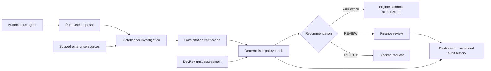

# Gate

### The smart contextual authorization layer for autonomous AI agents.

**Give agents the context to make informed decisions—and the controls to act responsibly.**

Gate connects enterprise evidence, deterministic policy, DevRev Gatekeepers, and human oversight in one decision workflow. Before an autonomous agent's proposed purchase is authorized, Gate checks the business context, verifies specific citations, evaluates spending controls, and explains the resulting recommendation.

Built for **Hack Midwest 2026**, Gate applies this approach to agent spending: every request carries a business purpose, supporting evidence, an explainable risk assessment, and a traceable review history. The React dashboard, PostgreSQL backend, and MCP tools share the same evidence and policy services, making the local workspace ready to run from a single command.

## Why Gate exists

An autonomous agent can identify a problem, suggest a tool, and initiate a purchase in seconds. Making an informed decision requires more context: which customer is affected, which ticket supports the request, whether the evidence is current, whether the merchant is permitted, and whether the purchase fits the agent's budget and authority.

Gate brings those questions into the authorization process. Agents receive scoped enterprise context and explicit next steps. Reviewers receive the sources, policy findings, and reasons behind the recommendation. Every decision can be inspected, challenged, and checked again as the underlying context changes.

## How it works

1. **Propose an action.** A purchasing agent submits its project, merchant, exact USD amount, category, purpose, and primary source reference.
2. **Investigate the context.** A Gatekeeper claims the request and retrieves authorized issues, tickets, accounts, and documents through Gate's MCP tools.
3. **Submit verifiable evidence.** The Gatekeeper cites exact source IDs, source and content hashes, verified relationships, and any unresolved questions. Gate validates the report against its stored source graph.
4. **Evaluate policy and risk.** The backend checks agent permissions, merchant status, budget, daily limits, duplicate intent, and evidence quality. DevRev trust signals add transaction-history context through a bounded, validated risk adjustment.
5. **Return an informed recommendation.** Gate produces `APPROVE`, `REVIEW`, or `REJECT`, with triggered rules, risk factors, and required resolutions. Eligible low-risk purchases can receive automatic sandbox authorization; purchases that require judgment go to finance review.
6. **Preserve the reasoning.** Evidence, policy versions, investigation reports, human reviews, and audit events remain attached to the request. Agents and reviewers can validate a saved decision against current conditions.



## Decisions backed by specific citations

Gate makes the path from a claim to its supporting record inspectable. Each evidence item includes a source ID and domain, a file locator and JSON pointer, dataset provenance, and source/content hashes. Relationships carry their own type and basis pointer so an agent can explain how an issue connects to a ticket or customer account.

The included synthetic Northstar example demonstrates that chain:

| Citation | Verified context | Source locator |
| --- | --- | --- |
| `pm:GATE-ISSUE-101` | An open export-queue issue references `GATE-TICKET-101`. | [main.json#/records/0](backend/data/synthetic/main.json) |
| `crm:GATE-TICKET-101` | Delayed scheduled reports affect `GATE-ACCOUNT-101`. | [main.json#/records/1](backend/data/synthetic/main.json) |
| `crm:GATE-ACCOUNT-101` | The affected customer is Northstar Analytics, an enterprise account. | [main.json#/records/2](backend/data/synthetic/main.json) |
| `document:GATE-DOC-101` | A support note acknowledges delayed reports and records that no purchase was authorized. | [main.json#/records/3](backend/data/synthetic/main.json) |

For a proposed **$1,700 diagnostics purchase**, the issue, ticket, and account establish the incident context. The support note adds an explicit boundary on the available evidence. Gate then applies the separate spending policy: an amount above the **$1,000 automatic authorization ceiling** requires human judgment, so this proposal receives `REVIEW` when the remaining checks pass.

An agent can explain the outcome precisely: “The request addresses the export delay documented in `GATE-ISSUE-101` and `GATE-TICKET-101`, affecting Northstar Analytics (`GATE-ACCOUNT-101`). Finance review is required because $1,700 exceeds the automatic authorization limit.”

Gate rejects invented citations, mismatched hashes, and unsupported relationships. Missing context, stale observations, contradictory facts, and unresolved questions become explicit evidence requirements. Source text is handled as untrusted data; permissions and policy remain server-owned.

## DevRev integration

DevRev provides the agent investigation and history-assessment paths in Gate's authorization workflow.

### Gatekeeper investigations through MCP

DevRev Gatekeepers use Gate's authenticated **Model Context Protocol (MCP)** interface to discover scoped resources, search business context, investigate proposals, submit cited evidence, and retrieve backend decisions. Purchasing and investigating agents have separate capabilities; finance authority is assigned independently.

The investigation lifecycle is persisted as `WAITING → INVESTIGATING → EVIDENCE_RECEIVED → EVALUATED`, with failures and unresolved questions recorded alongside the request. Claims are version-bound and time-limited, keeping concurrent agents and retries attached to the correct investigation.

### Trust assessment from transaction history

Gate's DevRev adapter sends a frozen, tenant-, agent-, and project-scoped history snapshot to the configured DevRev trust agent through an asynchronous API and receives its assessment through an authenticated webhook.

The agent reports signals such as an established reviewed purchasing pattern, an unusual amount, an unfamiliar merchant or category, or a repeated purchase attempt. **Every signal must cite supporting transaction IDs.** Gate verifies the cited records and the factual conditions behind each signal, calculates the adjustment itself, and reruns policy.

The adjustment is bounded to **−10 through +30 risk points**. An established pattern requires at least three independently confirmed legitimate purchases with a matching merchant/category and comparable amounts. Missing history remains neutral; invalid responses, unresolved questions, or timeouts require review. Hard denials and required evidence checks retain their authority.

See the [MCP tool schemas](backend/src/mcp-schemas.ts), [investigation contract](backend/docs/gatekeeper-investigations.md), and [DevRev trust connection guide](backend/docs/devrev-trust-connection.md) for implementation and configuration details.

## Explainable contextual authorization

Gate's backend produces a **Gate Contextual Spend Risk (GCSR)** score from explicit rule points, with a maximum of 100. Each recommendation includes the model and policy versions, triggered factors, rule results, and the reason for escalation. The score represents policy risk points, rather than a fraud probability.

| Control | What Gate evaluates |
| --- | --- |
| Agent authority | Active status, project access, and per-request spending cap. |
| Merchant policy | Allowed, review-required, or denied merchant status. |
| Financial limits | Available budget, daily spending, and request count. |
| Evidence quality | Required source coverage, verified links, freshness, and contradictions. |
| Business intent | Duplicate requests and repeated purchase patterns. |
| Historical trust | DevRev signals supported by verified transaction citations. |
| Human judgment | Amount thresholds, merchant exceptions, and other review requirements. |

Hard failures produce `REJECT`. Incomplete evidence and individual review rules require resolution even when the numeric score is low. The default policy requires human review for amounts above $1,000 and at a risk score of 40 or more.

Review decisions bind to an exact request version and snapshot hash. Reevaluation creates a new evidence and decision revision while retaining prior reviews. **Validate decision** compares the saved evaluation against current evidence, budget, duplicates, and policy, returning `VALID` or `CHANGED` with the backend's explanation.

See the [policy engine](backend/src/policy.ts), [evidence collector](backend/src/evidence.ts), and [trust validation rules](backend/src/trust-contracts.ts).

## The Gate dashboard

- **Transaction queue:** Inspect requests by agent, merchant, amount, status, risk, and time.
- **Request details:** Explore cited evidence, policy findings, investigation milestones, and required review actions.
- **Gatekeepers:** View agent scope and activity, and submit a labeled purchase scenario with a policy preview.
- **Decision validation:** Check whether a saved recommendation still matches current backend conditions.
- **Evaluation history:** Compare evidence and decisions across request versions, including their associated human reviews.
- **Policies and audit log:** Inspect published controls and trace request, investigation, and review events.

The dashboard reads PostgreSQL-backed API responses and refreshes every five seconds. The local demo opens directly into a prepared shared finance workspace. Gate's authenticated API and MCP routes apply their own identity, capability, and project checks.

The included demo uses labeled synthetic enterprise records and sandbox transactions. Sandbox receipts represent simulated money movement. Dashboard transaction reviews record the assessment and rationale against the reviewed snapshot.

## Run Gate locally

**Prerequisite:** Node.js **22.12+** and npm.

From the repository root:

```bash
./run-gate.sh
```

On Windows, double-click `run-gate.cmd` or run:

```powershell
./run-gate.ps1
```

The launcher installs dependencies as needed, starts or reuses local PostgreSQL, applies migrations, prepares the synthetic demo context, and starts the API, sandbox worker, and frontend. Existing history is preserved.

Open the dashboard address printed in the terminal, normally **http://127.0.0.1:5173**. Press **Ctrl+C** to stop services owned by the launcher. Logs and persistent local database files live under `backend/work/`.

To check startup and readiness automatically:

```bash
./run-gate.sh --smoke
```

Windows equivalent: `./run-gate.ps1 -Smoke`.

## Architecture and developer reference

| Layer | Technology and responsibility |
| --- | --- |
| Frontend | React, TypeScript, and Vite; request inspection, review, and decision validation. |
| API | Fastify and Zod; authenticated contracts, scoped access, and shared application services. |
| Data | PostgreSQL; enterprise source graph, requests, revisions, reviews, and audit records. |
| Agent interface | MCP SDK and eleven versioned tools for discovery, context, proposals, and investigations. |
| Policy | Deterministic TypeScript evaluation with explicit risk factors and evidence requirements. |
| DevRev | MCP Gatekeeper access plus asynchronous trust assessments and verified webhook results. |
| Sandbox execution | Durable worker, simulator receipts, idempotency, and recovery. |

```text
frontend/                 React dashboard and review experience
backend/src/              API, MCP, evidence, policy, trust, and worker services
backend/computer/         Gatekeeper connector and capability reference
backend/data/synthetic/   Versioned demo enterprise context
backend/docs/             Contracts, integration guides, and deployment reference
backend/tests/            Backend and workflow acceptance tests
scripts/                  Cross-platform launcher and startup checks
```

### Development checks

```bash
cd frontend
npm run build
npm test
npm run test:browser
```

```bash
cd backend
npm run typecheck
npm run build
npm test
```

### Documentation

- [API contracts](backend/docs/api.md)
- [Gatekeeper investigation lifecycle](backend/docs/gatekeeper-investigations.md)
- [DevRev trust integration](backend/docs/devrev-trust-connection.md)
- [Source ingestion and provenance](backend/docs/data-import.md)
- [Render deployment](backend/docs/render-deployment.md)
